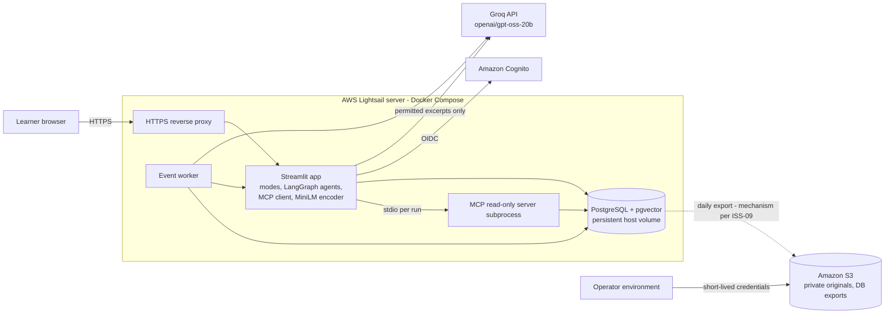
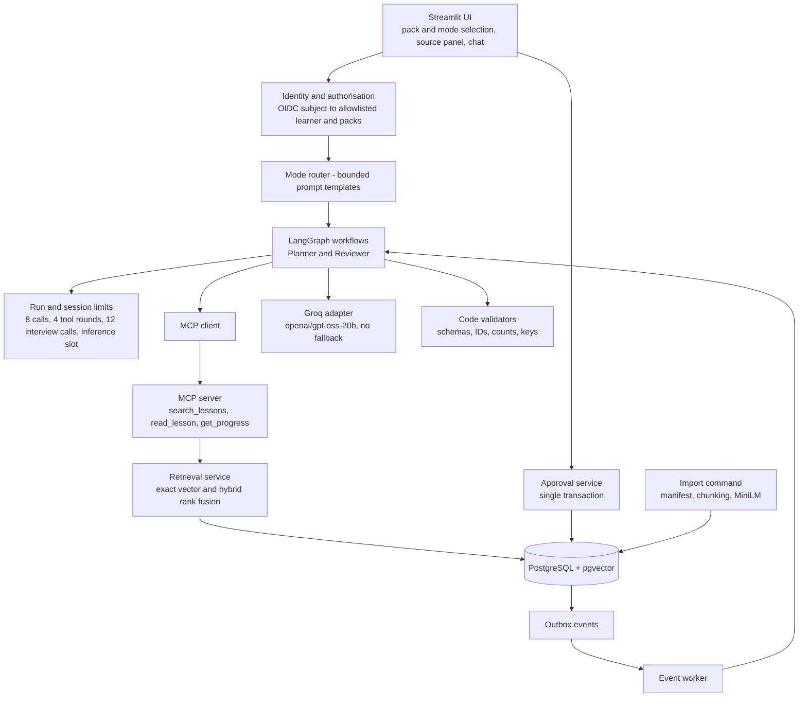
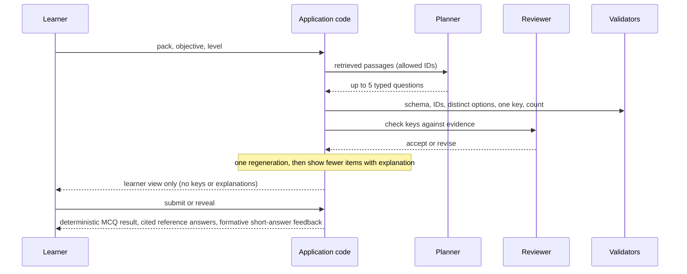

# ThreadWise AI Learning Companion — Architecture

Design for the four-week capstone, derived from the Version 7 documents (see [requirements.md](./requirements.md) for sources, constraints and open decisions). This is a design reference; nothing is implemented or provisioned yet. Where the source documents are ambiguous, the text says so and points to an `ISS-xx` item in the requirements.

## 1. Principles

1. **One application, four modes.** Learn, Practice, Interview and Plan share authentication, retrieval, the source panel, the model adapter and the two agent roles.
2. **Application code owns control flow and writes.** Limits, session transitions, authorisation and approvals are enforced in code, never by prompts, skill text or model output.
3. **Reads are separate from writes.** The MCP server is read-only; the application performs all writes through one approval transaction.
4. **Evidence over assertion.** Every factual claim cites an allowed passage. Source text is untrusted data.
5. **Small and replaceable adapters** for the database and model access.
6. **Same containers everywhere.** Codespaces and Lightsail use the same Compose definitions.

## 2. System context and deployment



- Only HTTPS (and its redirect) is public. SSH is limited to the operator. Database and application ports stay on the private Compose network.
- Groq is external to AWS. No generative model runs on the host and no SageMaker is used.
- The single server is a capstone trade-off: an outage affects application and database. Server volume is persistent storage, not a backup.

### Compose services

| Service | Responsibility | Notes |
|---|---|---|
| `app` | Streamlit UI, mode routing, LangGraph workflows, MCP client, query encoder | Encoder in image or persistent cache; measure cold-start memory |
| `db` | PostgreSQL with pgvector | Persistent volume; private network; no public port |
| `worker` | Outbox consumer that runs the same Planner/Reviewer workflow | Same image as `app`; shares the single inference slot |
| `proxy` | HTTPS termination with WebSocket support | Production override only |
| MCP server | Local stdio subprocess started by the app for each run | Not a long-running service; no network endpoint |

Development uses `app` and `db` through a devcontainer. A production override adds `proxy` and `worker` configuration.

## 3. Logical components



| Component | Responsibilities | Constraints |
|---|---|---|
| Identity and authorisation | Map the authenticated subject to a learner record and pack permissions; supply trusted context to every tool | Pack IDs from a model never grant access |
| Mode router | Select the Learn, Practice or Interview template; Plan uses the planning skill | Question counts and transitions are code-controlled |
| Retrieval service | Embed queries locally, search with workspace/pack/version filters, fuse keyword and vector results | Server-enforced filters; exact search first, hybrid as the required improvement |
| MCP server | Read-only lesson and progress access | Read-only database role; no write tools; closed after each run |
| Planner | Decompose goal, read evidence, draft plan or questions | Own prompt, message state and tool allowlist |
| Reviewer | Check evidence and the mode rubric; produce accept/revise or formative feedback | Cannot approve writes; may share the model with the Planner, so agreement is not proof |
| Validators | Schema, allowed passage IDs, distinct options, one key, question count, valid lesson IDs, time budgets | Deterministic; semantic correctness is a human check |
| Approval service | Validate owner, proposal, expiry and version; apply change, audit and outbox event atomically | Idempotent; no write on reject, stale, expired, repeated or wrong-owner requests |
| Event worker | Claim events with a lease; create pending proposals | At-least-once with deduplication; rechecks enrolment and versions |
| Import command | Validate manifest, chunk, embed, version and publish packs | Atomic publish; vector cache by source hash |

## 4. Data model (logical)

The AD minimum data model is extended with the items marked **gap**, which other sections of AD require (ISS-08). Table and column names are decided in week 1.

| Entity | Key content | Notes |
|---|---|---|
| Workspace, pack, pack version | IDs, version, status (active/withdrawn), manifest, permitted learners, lessons, prerequisites, durations | Packs publish atomically |
| Learner and enrolment — **gap** | Identity subject, learner ID, allowed packs, status | Separate from Cognito identity |
| Source and passage | Workspace/pack/version IDs, URL or key, hash, lesson ID, section/page, text, `vector(384)`, embedding model revision | Also holds a keyword search index for hybrid retrieval |
| Plan and progress | Owner, item IDs, estimated minutes, state, record version | Self-reported completion; no mastery inference |
| Proposal and approval | Exact changes, evidence, expected version, expiry, owner, reviewer, status | Persisted before approval; a proposal is not a plan |
| Learning session | Owner, pack version, mode, turns, question schema, rubric, evidence IDs, feedback, call counters | Server-side keys; resumable |
| Workflow checkpoint and run — **gap** | Run ID, owner, graph state, skill version, model ID, call/tool counters | Restart/resume |
| Audit event | Run ID, tool result, idempotency key, actor | Written in the approval transaction |
| Outbox event — **gap** | Event ID, state, lease, attempts, unique event-to-proposal key | Pending / processing / completed / failed |
| Preferences and notices — **gap** | Next-step suggestions opt-in, session-history acknowledgement | |
| Memory — **gap** | Long-term (approved goals, plans, progress); episodic (previous proposals, learner-confirmed feedback) by owner and pack | Bounded retrieval |

Isolation rule: every query that returns pack content or learner data carries workspace, pack (or version) and owner filters set by trusted application code.

## 5. Key flows

### 5.1 Learn

1. Learner selects pack, level and topic. Missing goal or time triggers a clarifying question.
2. Retrieval returns allowed passages (exact vector first; hybrid after week 2).
3. The model drafts a cited explanation with labelled generated examples; unsupported requests produce an abstention.
4. Validators check cited passage IDs against the retrieved, authorised set.

### 5.2 Practice (at most five questions)



Keys and explanations stay server-side until submission or reveal. No score marks a lesson complete.

### 5.3 Interview (three questions plus at most one follow-up)

1. Generate and review three main questions; persist a pinned-version session with call counters.
2. Ask one question; the application waits and releases the inference slot.
3. On each answer, the Reviewer compares it with reference concepts and cited passages. Blank or insufficient answers lead to retry or skip.
4. The application may permit one follow-up, selected from a concrete gap; it counts toward the four-question maximum.
5. The final summary lists strengths, specific gaps and one suggested learning activity, and labels limits.
6. Enforce 12 model calls and four learner questions in stored state. Sessions pause and resume. Observations never change plans or progress.

### 5.4 Plan, approval and completion event

```mermaid
sequenceDiagram
  participant U as Learner
  participant App as Application code
  participant P as Planner
  participant R as Reviewer
  participant DB as PostgreSQL
  participant W as Event worker
  U->>App: goal and time budget
  App->>P: skill, bounded memory, MCP read results
  P-->>App: draft plan
  App->>R: evidence and plan rubric
  R-->>App: accept or revise (one revision, one final review)
  App->>DB: persist proposal (no plan change)
  App-->>U: show exact proposal
  U->>App: approve or reject
  App->>DB: ONE transaction - validate owner, proposal, expiry, version; apply change; audit; outbox event; idempotency key
  DB-->>W: pending event
  W->>App: Planner and Reviewer workflow (same limits)
  App->>DB: save pending next-step proposal (requires separate approval)
```

Progress updates follow the same path. Rejected, stale, expired and repeated requests produce no write.

### 5.5 Ingestion and publication

1. Operator provides a reviewed manifest and source files (English text, Markdown or text-based PDF).
2. Verify extraction against originals; record title, URL or file, version, section/page, permitted use and hash.
3. Split by headings and the tokenizer within 256 word pieces with small overlap; embed with the pinned MiniLM revision; reuse cached vectors for unchanged hashes.
4. Publish the new pack version atomically; superseded passages are excluded; a pack version can be withdrawn.

## 6. Agent design

- **LangGraph** coordinates two roles with separate prompts, message state and tool allowlists. No additional autonomous agent or framework is added.
- **Termination:** one revision and one final review, then stop with an explanation. Caps (8 calls, 4 tool rounds per run; 12 calls per interview; one active inference run) are checked by application code before each model or tool call. Hitting a cap pauses or ends generation, writes nothing and preserves a checkpoint.
- **Planning skill:** a versioned package (`SKILL.md`, instructions, plan schema, reviewed examples). Its version is recorded per run. Skill text cannot widen tool permissions.
- **Memory:** short-term in graph state; long-term and episodic memory in PostgreSQL, owner- and pack-scoped; only bounded, relevant episodes are retrieved; no private reasoning is stored.
- **Untrusted content:** passages, learner input and model output are data. Prompt-injection cases (including "embedded instructions" in the ten action-control tests) must not trigger a tool call, a write or an approval.
- **Reviewer independence:** the application Reviewer and the release judge are separate calls. Even so, same-model agreement is not correctness evidence.

## 7. Security architecture

| Concern | Control |
|---|---|
| Authentication | Streamlit OIDC with Cognito; public sign-up disabled; pilot users pre-created |
| Authorisation | Application allowlist for learners and packs; trusted context bound outside model arguments; enrolment checked in every tool and citation fetch |
| Tool access | MCP server uses a read-only database role; no write tools; closed after each run |
| Write integrity | One transaction with owner, proposal, expiry and version validation, audit and idempotency |
| Isolation | Owner/workspace/pack filters on every query; owner-specific cache keys only |
| Secrets | Codespaces secrets and restricted server configuration; none in the repository; excluded from logs |
| Outbound data | Only agreed permitted payloads sent to Groq (ISS-04); no keys exposed to untrusted pull requests |
| Network | HTTPS only; database and app ports private; SSH limited to the operator |
| Logging | Tool names, scoped source IDs, results and errors; no secrets or private reasoning; bounded retention |

## 8. Model access

- Provider: Groq; model `openai/gpt-oss-20b`. The adapter accepts a single configured model and has **no fallback** to another model, provider or paid plan.
- Use structured outputs for typed schemas and always validate in code; a schema-valid response is not semantically correct.
- Bound context, output, retries and tool steps. On rate limiting, back off with a bounded delay, show a retry message and keep state.
- Free-tier limits apply to the provider account and are shared by practice, interview, judge and agent calls. Verify actual limits in week 1 and measure calls and tokens per mode.

## 9. Environments, branches and CI

- **Codespaces:** a devcontainer with pinned dependencies, a pgvector container and setup, import, test and reset commands; a cached embedding model. Keep one Codespace across the weekly branches, commit before switching and use versioned migrations with checkpoint-specific reset steps. Stop idle Codespaces.
- **Branches:** `week-01` through `week-04`, each created from the accepted tip of the previous one and reviewed against it. Immutable tags such as `cohort-01-week-02-v1`. `main` remains the stable guide.
- **CI (GitHub Actions):** on pull requests and pushes to reviewed branches run schema, retrieval-fixture, practice-key visibility, interview state, authorisation, approval and event tests. Fixtures are version-controlled and labelled as replayed outputs. A deliberately failing control blocks the check. Publish a small report artifact.
- **Live evaluation:** a separate, manually triggered workflow on trusted code with protected secrets; never exposed to untrusted pull requests.

## 10. Operations

| Area | Design |
|---|---|
| Hosting | One Lightsail Linux server, 4 GB as a sizing hypothesis; measure app, database, encoder, worker and proxy together; 8 GB is the fallback sizing |
| Release | Pinned image from an accepted tag; back up; apply migrations; run production Compose; retain the previous image and a compatible backup |
| Backup | Export PostgreSQL daily during the pilot and before each migration to private, versioned, encrypted S3; test a full restore (mechanism: ISS-09) |
| Monitoring | Bounded logs; AWS Budget alerts; weekly cost review; record account owner, budget and cleanup date |
| Recovery tests | Restart, rejected approvals, quota exhaustion, restored learner plan |
| Cleanup | Back up, then delete unneeded billable resources (servers, snapshots, storage, IPs) after the pilot |

## 11. Traceability to the curriculum (planned evidence)

| Topic | Architecture element | Evidence |
|---|---|---|
| Agent loop | LangGraph workflows with stop conditions | Goal, tool results and bounded termination trace |
| Connectivity | MCP read server and planning skill | Protocol trace, denial case, skill reuse |
| Memory | Short-, long- and episodic memory | Feedback recall, owner isolation, restart restore |
| Multiple agents | Planner and Reviewer | Role handoff, seeded bad proposal corrected |
| Workflow state | Checkpoints and approval transaction | Reject, stale, repeated and restart cases |
| Automation | Outbox worker | Trigger, deduplication, crash recovery |
| Assembly | Audit trail and permission review | End-to-end journey without unauthorised writes |

Named tools not used (CrewAI, CrewAI Flows, n8n, FAISS, Qdrant) are not claimed; see ISS-16.
