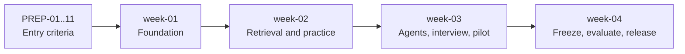

# ThreadWise AI Learning Companion — Backlog

Cumulative milestones `week-01` to `week-04` derived from the Version 7 documents. Requirement IDs refer to [requirements.md](./requirements.md); design references are in [architecture.md](./architecture.md). Nothing here adds scope: every task traces to a stated requirement. Status values: `todo`, `in progress`, `blocked`, `done`.

## How to use this backlog

- A task is done only when its **acceptance criterion** is met and evidence is committed or linked.
- A task may start only when every item in **Depends on** is done. `ISS-xx` dependencies mean the open decision in requirements section 13 has been recorded.
- Each milestone ends with a review against the previous branch and an immutable tag (for example `cohort-01-week-01-v1`). Fixes propagate forward as new tag versions.
- A week's work is cumulative; never remove human review, source checks or approval tests to recover schedule (C-14). If week 3 slips, cut topic breadth and visual polish first and record a scope decision.
- Do not start any task outside the current milestone without a recorded scope decision.
- **Codespace deferred (ISS-17).** No Codespace exists yet. Tasks that need a running stack (`W1-01` validation, `W1-12`, `PREP-08`, and the week-01 "clean startup" gate evidence) cannot be marked done until verified in a Codespace.

## Entry criteria — before week-01 starts

Preparation, not product features. The four-week schedule assumes these are complete (AD "Four week delivery safeguards").

| ID | Task | Acceptance criterion | Depends on | Reqs |
|---|---|---|---|---|
| PREP-01 | Obtain assessor decisions on the full capstone rubric and any required named tools (CrewAI, CrewAI Flows, n8n, FAISS, Qdrant, Langfuse, `/ask`) | Written decision per tool recorded under ISS-16; if any are required, scope change is agreed before week-01 | — | ISS-16, C-15 |
| PREP-02 | Name roles and effort: workspace owner, content owner, reviewer, developer(s), operator, AWS account owner, budget owner; agree weekly hours and team size | A table with named people and hours per week is added to this file; distinguishes who builds from who prepares | — | ISS-14 |
| PREP-03 | Primary learning pack ready: rights confirmed and recorded, manifest drafted, extraction verified against originals | Per-source record of title, URL/file, version, section/page, permitted use and licence notice; reviewer signs off; ten pilot questions, two study plans, one five-question practice set and one short interview with reference answers drafted | PREP-02 | D-02, D-03 |
| PREP-04 | Second authentic pack from a different subject ready | Same evidence as PREP-03; the pack is a different subject and is not derived from the first | PREP-02 | C-04, D-07 |
| PREP-05 | 36 scenarios labelled (24 development, 12 holdout) with a protected holdout store | Cases follow the section 11.1 coverage table and record pack and source hashes, objectives, reference concepts, passage IDs and rubric; holdout is stored outside learner-visible repositories (ISS-07); every mode appears in each pack | PREP-03, PREP-04 | 11.1, ISS-07 |
| PREP-06 | Starter adapters for MCP, OIDC/Cognito, outbox/events and CI | Each adapter has a documented smoke test that passes in a clean Codespace | PREP-02 | AD preparation |
| PREP-07 | Groq access verified | `GROQ_API_KEY` is in Codespaces secrets; a smoke test shows `openai/gpt-oss-20b` availability, tool output and structured output; actual account limits recorded | — | C-08, C-10 |
| PREP-08 | Encoder verified in a clean Codespace | Chunk lengths ≤ 256 word pieces, 384-dimension vectors, model revision pinned, memory use recorded | — | C-09, D-04 |
| PREP-09 | External-processing and data policy | Per-mode Groq payload allowlist, exclusions, retention and learner notice approved (ISS-04); content owner agrees to external processing | PREP-02 | S-08, ISS-04 |
| PREP-10 | Pilot infrastructure decisions | AWS region, hostname, Cognito configuration, pilot users (up to about five), account owner, budget target, cleanup date and Codespaces entitlement recorded | PREP-02 | O-07 |
| PREP-11 | Quality thresholds and open decisions agreed | Thresholds in section 11.2 confirmed by the stakeholder; ISS-01, 02, 03, 05, 06, 08, 09, 10, 11, 12, 13, 15 each have a recorded decision in requirements section 13 | PREP-01, PREP-02 | 11, 13 |

## week-01 — Foundation

**Cumulative outcome:** Codespaces environment, reviewed packs, evaluation cases and basic Learn mode. **Review evidence:** clean startup, source rights, model access, baseline responses.

| ID | Task | Acceptance criterion | Depends on | Reqs |
|---|---|---|---|---|
| W1-01 | Devcontainer, Compose (app and pgvector db), pinned Python dependencies, setup/import/test/reset commands | A fresh Codespace reaches a running app and healthy database with documented commands; reset returns to a clean state; versions recorded (ISS-15) | PREP-11 | C-06, C-07, O-01 |
| W1-02 | Versioned migrations for pack, source/passage (`vector(384)`), learner/enrolment, plan/progress, proposal, session, run/checkpoint, audit, outbox, preference and memory entities | Migrations apply from empty; schema tests pass; each entity named in architecture section 4 exists or has a recorded reason for deferral; reset and rollback steps documented | W1-01, PREP-11 | D-01, ISS-08 |
| W1-03 | Pack manifest format and import command | Both packs import from manifests without code changes; invalid manifests are rejected with a clear error; versions and hashes are stored | W1-02, PREP-03, PREP-04 | D-02, D-07, D-09 |
| W1-04 | Ingestion: heading and tokenizer chunking with overlap, pinned MiniLM revision, vector cache | Every chunk is ≤ 256 word pieces; the revision is stored in the corpus manifest; re-importing unchanged sources performs no re-encoding | W1-03, PREP-08 | C-09, D-04 |
| W1-05 | Groq adapter: structured output, tool-call support, bounded retries and backoff, usage logging, no fallback | Smoke test records model ID, latency and tokens; the adapter rejects any model other than the configured `openai/gpt-oss-20b`; a test proves no alternate provider or paid path exists; payloads conform to the PREP-09 allowlist | W1-01, PREP-07, PREP-09 | C-08, C-10, S-08 |
| W1-06 | Server-enforced retrieval filters (workspace, pack, version) with exact vector search | Query for a pack the learner is not enrolled in returns nothing; cosine search returns labelled passages for ten pilot questions | W1-02, W1-04 | D-05, D-06, S-02 |
| W1-07 | Streamlit shell with pack and mode selection, source panel and basic Learn mode | The ten pilot questions yield cited, level-appropriate answers; an unsupported question is abstained; ambiguous goal triggers a clarifying question | W1-05, W1-06 | L-01 to L-04 |
| W1-08 | Evaluation harness skeleton: case schema, fixture loader, baseline runner | Development cases load with pack and source hashes; baseline Learn results, latency and tokens are recorded in a report; holdout files are not present in the repository | W1-07, PREP-05 | 11.1, ISS-07 |
| W1-09 | OIDC/Cognito validation spike | Login with a test Cognito pool works through Streamlit OIDC; unauthenticated access is denied; allowlist check is separate from authentication | W1-01, PREP-06, PREP-10 | S-01, ISS-02 |
| W1-10 | Logging policy and redaction | Tests show secrets and private reasoning never appear in logs; logs are bounded | W1-05 | S-04 |
| W1-11 | CI skeleton | A pull request runs schema and unit tests and uploads a small report; a deliberately failing check blocks the pull request | W1-02, PREP-06 | 11.6 |
| W1-12 | Measure cold-start time and memory (app, database, encoder) and AWS deployment scaffold | Numbers are recorded; production Compose override (proxy) builds locally; resource checklist, budget alert plan and cleanup date are written; no resources are provisioned | W1-04, W1-07, PREP-10 | O-02, O-07 |

**Gate for tag week-01:** clean startup, ten pilot questions answered, baseline and initial latency recorded, source rights evidence present, model access shown, OIDC spike shown.

## week-02 — Retrieval and practice

**Cumulative outcome:** cited retrieval, MCP reads, planning skill and five-question Practice across two packs. **Review evidence:** retrieval comparison, MCP trace, skill reuse, content update, pack isolation, practice-key checks.

| ID | Task | Acceptance criterion | Depends on | Reqs |
|---|---|---|---|---|
| W2-01 | Hybrid retrieval (PostgreSQL keyword plus vector with rank fusion) and comparison with exact search | Same development cases, corpus and model for both methods; Recall@5 and answer quality reported separately; exact search remains available; failure examples preserved | W1-06, W1-08 | D-06, 11.2 |
| W2-02 | Citation model and scoped fetch | Every factual claim carries allowed passage IDs and source/section/page; fetching a passage outside the learner's authorised pack is denied; citations reproduce for the pinned version (decision ISS-10 applied) | W1-07, ISS-10 | L-01, S-02 |
| W2-03 | Atomic pack versioning and content update | One content update is published; superseded passages disappear from retrieval; old sessions stay pinned; withdrawal stops sessions for review | W1-03, W1-06 | D-07, S-07 |
| W2-04 | MCP stdio client and read-only server with `search_lessons`, `read_lesson`, `get_progress` | A real MCP protocol call is traced; trusted learner/pack context is bound outside model arguments; an unauthorised pack is denied; the database role is read-only; the subprocess closes after the run (decision ISS-03 applied) | W1-06, W1-09, PREP-06, ISS-03 | A-05, A-06 |
| W2-05 | Study-planning skill package | `SKILL.md`, schema and reviewed examples exist; metadata is discovered and the skill version is recorded; selection and version are visible in runs on both packs; skill text cannot widen tool permissions (tested) | W2-04 | A-07 |
| W2-06 | Bounded LangGraph run foundation | Per-run caps (8 model calls, 4 tool rounds) and the single inference slot are enforced in code and tested; exceeding a cap writes nothing and returns an explanation; slot priority between learner runs, worker and evaluation defined (ISS-11) | W1-05, ISS-11 | A-03, A-04 |
| W2-07 | Practice generation schema and validators | Typed schema from P-02; code rejects bad schema, unknown passage IDs, non-distinct options, more than one key or more than five items; fixtures prove each rejection; one regeneration then fewer items with an explanation | W2-02, W2-06 | P-01 to P-05 |
| W2-08 | Reviewer key check for Practice (minimal Reviewer role; decision ISS-01 applied) | Seeded wrong keys, ambiguous MCQs, unsupported explanations and a valid alternative answer are detected or accepted as expected | W2-07, ISS-01 | P-04, 11.4 |
| W2-09 | Practice interface and server-side key protection | Learner view before submission or reveal contains no keys or explanations (client payload, cache and log tests); MCQ scoring is deterministic; short-answer feedback cites sources and accepts valid paraphrases; no score marks a lesson complete | W2-07, W2-08 | P-06 to P-08 |
| W2-10 | Enrolment model and authorisation enforcement | Subject-to-learner and learner-to-pack mapping enforced in every tool and citation fetch; wrong pack and non-enrolled learner are denied; owner-specific cache keys only | W1-02, W1-09 | S-02, S-03 |
| W2-11 | Source-as-untrusted-data tests | Injected instructions in a development passage do not cause a tool call, write or approval; case is in the development set | W2-02, W2-06 | S-02, 11.1 |
| W2-12 | Evaluation of week-02 development cases | Learn and Practice development cases run with recorded latency, tokens, calls, failures and quota errors; prompt and schema failure examples preserved | W2-01, W2-09, PREP-05 | 9, 11 |
| W2-13 | CI additions | Retrieval fixtures, practice-key visibility, pack isolation and authorisation tests run in CI and the intentional failing control still blocks | W1-11, W2-09, W2-10 | 11.6 |

**Gate for tag week-02:** two packs, correct keys, retrieval comparison, MCP trace, skill reuse on both packs, content update and pack isolation evidence.

## week-03 — Agents and interview

**Cumulative outcome:** bounded Interview, Planner and Reviewer, plans, memory, approvals, one completion event, checkpoints and authentication. **Review evidence:** feedback and cap checks, handoff, approval and recovery, authenticated AWS pilot.

| ID | Task | Acceptance criterion | Depends on | Reqs |
|---|---|---|---|---|
| W3-01 | Full Planner/Reviewer handoff in LangGraph | Separate prompts, message state and tool allowlists; one revision and one final review; a seeded invalid plan is caught; revision limit terminates with an explanation; role traces are separate | W2-06, W2-08, W2-05 | A-01, A-02 |
| W3-02 | Persistent checkpoints and resumable sessions | Restart restores run and session state by owner and run ID; pause/resume works for Practice and Interview; call counters persist across resume | W1-02, W3-01 | A-04, I-08 |
| W3-03 | Mode router and bounded prompt templates | Learn, Practice and Interview use shared read tools through separate templates; transitions and question limits are controlled in code and tested | W2-09, W3-01 | A-08 |
| W3-04 | Interview workflow | Three reviewed questions asked one at a time; at most one follow-up in the whole session, counted toward four; blank/insufficient answers trigger retry or skip; 12-call and four-question caps enforced; pause/resume works | W3-02, W3-03 | I-01 to I-08 |
| W3-05 | Interview feedback and summary quality checks | Feedback cites sources, accepts valid alternatives, makes no personality, confidence, employability or readiness claims; summary reflects observed turns and labels missing data; seeded unsupported criticism and overconfident summary are caught | W3-04 | I-05, I-07, 11.3 |
| W3-06 | Plan mode and proposal persistence | Plans use valid lesson IDs, fit the time budget, respect prerequisites, cite resources and label estimates (checks decided in ISS-12); the proposal is stored before approval and no plan changes; missing time or goal triggers clarification | W3-01, W2-05, ISS-03, ISS-12 | PL-01, PL-02 |
| W3-07 | Approval transaction | One transaction validates owner, proposal, expiry and version; applies change, audit and idempotency key; all ten action-control tests (approve, reject, expired, stale, duplicate, restart, wrong owner, embedded instructions, wrong pack, revoked access) pass against real state and audit events | W3-06, W2-10 | 6, 11.2 |
| W3-08 | Progress update proposals and completion outbox event | Self-reported progress is proposed and approved separately from plans; the outbox event is written in the same transaction; quiz and interview results never mark completion | W3-07 | PL-04, PL-05 |
| W3-09 | Memory | A follow-up uses saved, learner-confirmed feedback; another learner cannot retrieve it; restart restores memory; raw scores stay session observations; episodes retrieved are bounded | W3-02, W3-07 | M-01, M-02 |
| W3-10 | Outbox worker and next-step suggestions | Lease-based claim, bounded retries and four states; unique event-to-proposal key; tests for duplicate delivery, crash after proposal creation, revoked enrolment and quota failure produce no duplicate or unauthorised plan; suggestion stays pending until separately approved; opt-in respected | W3-08, W2-06, PREP-06 | E-01 to E-04 |
| W3-11 | Consent and session-history notice, pack withdrawal handling | Visible notice before history is stored; withdrawn pack version stops the session for review | W3-02 | S-06, S-07 |
| W3-12 | Cognito authentication end to end | Pre-created users, public sign-up disabled; authorisation remains a separate allowlist; denial paths tested | W1-09, W2-10, PREP-10 | S-01 |
| W3-13 | Lightsail pilot deployment | Production Compose with HTTPS/WebSocket proxy runs on a Lightsail server; database not publicly reachable; only HTTPS and redirect exposed; authenticated login and pack access verified; measured startup memory and concurrent sessions recorded; 4 GB versus 8 GB decision made on measurement; budget alerts set; "complete" defined per ISS-02 | W3-12, W1-12, PREP-10, ISS-02 | O-01, O-02, S-05 |
| W3-14 | S3 and backup mechanism | Private, encrypted, versioned bucket with retention; daily export mechanism, failure detection and retention implemented per ISS-09; one export uploaded | W3-13, ISS-09 | O-03, O-04 |
| W3-15 | Audit and metrics | Role traces, tool names, scoped IDs and errors logged; latency, tokens, calls and quota failures captured per request, practice set and complete interview | W3-01, W3-04 | 9, S-04 |
| W3-16 | CI additions | Interview state, approval, event and authorisation tests run in CI | W3-04, W3-07, W3-10 | 11.6 |

**Gate for tag week-03:** interview feedback and cap checks, handoff, approval and recovery evidence, and an authenticated AWS pilot.

## week-04 — Release

**Cumulative outcome:** feature freeze, quality evaluation and deployment. **No new modes or features.** **Review evidence:** per-mode results, judge audit, restore test, evidence index.

| ID | Task | Acceptance criterion | Depends on | Reqs |
|---|---|---|---|---|
| W4-01 | Freeze and agree thresholds | Thresholds in section 11.2 signed off with decisions ISS-05, ISS-06 and ISS-13 recorded; code tag, corpus hash, model ID, prompts, skill and rubrics frozen and listed | W3-16, W3-13, PREP-11, ISS-05, ISS-06, ISS-13 | 11.5 |
| W4-02 | CI regression and fixture check | Full CI passes, including all ten action-control tests and mode, MCP, memory, event and CI checks; the intentional failure still blocks; report archived | W3-16 | 11.2, 11.6 |
| W4-03 | Live evaluation workflow | Manually triggered, trusted-code, protected-secret workflow runs in small batches with bounded retries; no keys are exposed to untrusted pull requests | W4-01, PREP-07 | S-09, 11.6 |
| W4-04 | Development-cases pre-check and judge calibration | Seeded failures and valid alternatives are included; no holdout data used; judge prompt uses the written rubric, sources and references and is a separate model call from the application Reviewer | W4-03, PREP-05 | 11.4 |
| W4-05 | Holdout run (once) | All 12 holdout scenarios run against the frozen build; results reported by mode and pack with denominators and every failure; quota failures recorded | W4-04 | 11.5 |
| W4-06 | Human review of all holdout outputs | Every Learn and Plan output, all 15 practice items, 12 interview feedback turns and three summaries are reviewed with rationale; hard failures noted | W4-05 | 11.4 |
| W4-07 | Judge audit | At least 12 judge ratings (four Learn, four practice, four interview) compared with human labels; pass/fail agreement, per-dimension differences, false passes and false failures recorded; adjudication recorded | W4-06 | 11.4 |
| W4-08 | Cost, latency and resource evidence | Latency, tokens, calls, quota failures per request, practice set and complete interview; cold and warm memory; AWS spend and alerts reviewed | W3-15, W4-05 | 9, O-07 |
| W4-09 | Recovery and operations tests | Full PostgreSQL restore from S3 verified, including a restored learner plan; restart, rejected approvals and quota exhaustion tested; previous image and compatible backup retained | W3-14, W3-13 | O-04, O-06 |
| W4-10 | Repair loop | Defects are fixed on a new tag with a new versioned evaluation if the build changes; repeated attempts are not reported as independent; no holdout tuning | W4-06, W4-07 | 11.5 |
| W4-11 | Release decision | A written RELEASE, HOLD or INCONCLUSIVE report lists each gate, denominators, failures and limits; known blocking failure produces HOLD; missing evidence produces INCONCLUSIVE; the report states that results do not prove universal accuracy or learning gains | W4-02, W4-05 to W4-09 | 11.5 |
| W4-12 | Release deployment | Only if W4-11 is RELEASE: pinned image from the release tag, backup, migrations, production Compose; authentication, restart and restore smoke tests pass | W4-11, W4-09 | O-05 |
| W4-13 | Evidence index and deliverables | Index links code and tags, skill package, MCP trace, corpus manifest and hash, CI report, evaluation report, curriculum checklist (topics marked implemented, conceptual, deferred or awaiting rubric confirmation) and operating guide | W4-11 | 12 |
| W4-14 | Integrated demonstration | Scripted run: cited explanation, reviewed practice set, short interview with feedback, plan request, MCP and handoff trace, approval, completion confirmation, event-generated suggestion, restart with no duplicate updates | W4-12, W4-13 | 12 |
| W4-15 | Cost cleanup | After backing up required data, unneeded billable resources are removed or scheduled for removal by the recorded cleanup date | W4-09, W4-14 | O-07 |

**Gate for tag week-04:** release criteria reviewed, restore tested, release tag, operating guide and demonstration ready.

## Dependency overview

## Risks to watch

| Risk | Signal | Response |
|---|---|---|
| Preparation incomplete | Any PREP item open at week-01 start | Extend the schedule or agree a reduced scope; do not compress evaluation into the last days |
| Week-03 overload | W3-07, W3-10 or W3-13 behind schedule by mid-week | Reduce topic breadth and polish first; record any other deferral as a scope decision |
| Groq quota or latency | Quota errors or slow runs in week-02 measurements | Bounded backoff and smaller batches; never add a paid or alternate model |
| 4 GB host insufficient | Memory pressure when app, database, encoder and worker run together | Record the measurement; consider the 8 GB server and the larger budget reserve |
| Holdout contamination | Holdout material seen in learner repositories or tuning | Re-version the evaluation and report the history |
